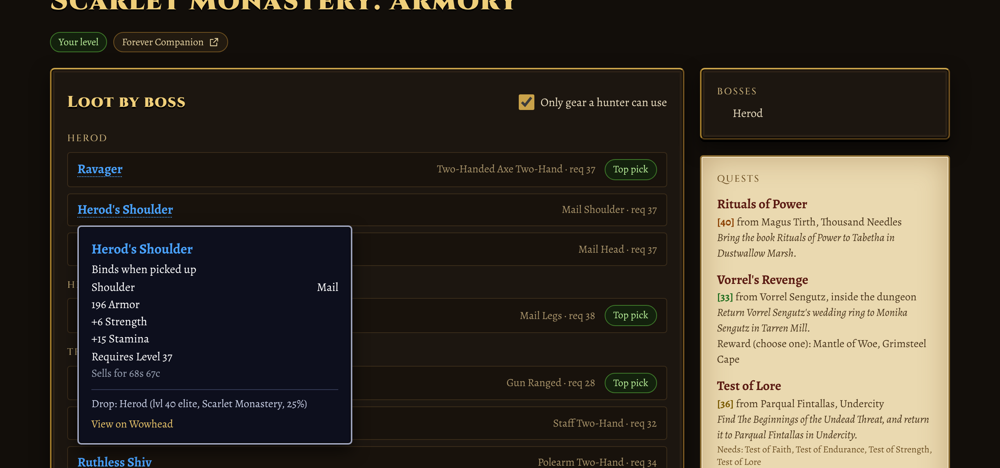

# Wayfarer's Almanac

A companion app for **World of Warcraft: Forever**. It tells you what's coming at your next levels, which dungeons and quests fit you, the best gear you can get at each level, and how to level your professions. The first fully written class is the **hunter**, with Engineering and Mining.


## What's in it

| Page | What it does |
|---|---|
| **Guidance** | Your next big milestone (for example *mail armour at 40*), a level-by-level road ahead for the next 5, 10 or 20 levels, what unlocked at your level, gear to keep for an upcoming armour unlock, dungeons and key quests for your level, and profession goals. |
| **Talents** | Talent planner for all nine classes with the Forever trees (including the new 16-point milestones), row gates, prerequisites, Legacy bonus points and full rank text. |
| **Dungeons & Raids** | All Forever dungeons with level ranges and difficulty colours. Each dungeon shows loot by boss (filtered to your class, with full item tooltips), its quests and bosses. Forever's first three raids and the content roadmap. |
| **Gear** | Best in slot for any level from 1 to 60, ranked with rough class stat weights. Choose whether to include crafted gear, rare world drops and raid loot. Crafted items are flagged when your professions can make them. |
| **Quests** | Dungeon and elite quests near your level, searchable, with rewards, XP and prerequisites, plus your class quests and the Waylaid Supplies reputation. |
| **Professions** | Engineering and Mining: training tiers, the fastest Engineering path to 300, specialisations, mining nodes coloured by your skill, smelting, camp items, Forever changes, and every craftable Engineering item. |
| **Collections** | Rare beasts to tame (for hunters), mounts and companion pets, with an owned checklist saved in your browser. |
| **Sources** | Where every piece of data comes from. |

Your character (class, level, faction, professions) is set by clicking it in the header and is saved in your browser.



## Data

Blizzard's official API doesn't yet expose trainer spells or dungeon loot for Forever, so the app combines:

- **[Forever Companion API](https://forevercompanion.io/developers)**: dungeons, loot, quests, class quests, rares and reputations.
- **[wow-forever-kb](https://github.com/gBlaku/wow-forever-kb)**: item stats and sources (trimmed to gear, mounts, pets and crafts).
- **[Talents Forever via WoW Forever Talent](https://wowforevertalent.com/sources/)**: talent trees and rank text, CC BY 4.0.
- **Hand-curated files** in `src/data/`: hunter unlocks by level, general milestones, professions and raids. Anything carried over from Classic and not yet confirmed for Forever is marked *Unconfirmed* in the app.

`npm run snapshot` downloads all of it into `public/data/` (not committed, since two sources state no licence for redistribution). The app reads only those bundled files, so it runs standalone with no calls to other sites. Set `VITE_DATA_MODE=live` to read the community feeds directly instead.

## Live character tracking

The Progress page and the header follow your real character, read from Blizzard's WoW Forever Profile API
(`profile-forever-{region}` namespace): level, class, faction, professions, talent points per tree, equipped gear and item level.

1. Create a free API client at <https://develop.battle.net/access/clients>.
2. Add `BLIZZARD_CLIENT_ID` and `BLIZZARD_CLIENT_SECRET` as environment secrets (never commit them).
3. Put your character in `sync.config.json` as `"character": "name-surname"` with `"region": "eu"` or `"us"`.
4. Run `npm run sync:character`. It rewrites `src/data/character.json` only when something changed and prints what changed.

A daily scheduled job runs the sync. When it reports changes, it commits them on a `sync/character-YYYY-MM-DD` branch,
opens a pull request with the change list, then rebuilds and republishes the hosted page.
Blizzard lists a character from level 10, and only after it logs out. Edits you make by hand in the app stay until the next sync.

## Develop

```sh
npm install
npm run snapshot          # download game data into public/data (takes a minute; respects rate limits)
npm run dev               # http://localhost:8080
npm test                  # unit tests (vitest)
npm run build             # type-check and build to dist/
npm run build:standalone  # one self-contained page in dist-standalone/ (artifact.html + data/)
```

Stack: Vite, React 18, TypeScript and Tailwind CSS. Routing uses plain hashes (`#gear`, `#dungeon-sm-armory`), so the build can be hosted anywhere as static files, including as a Claude artifact. There is no backend and nothing to log in to.

## Adding a class

Write a milestone list like `HUNTER_MILESTONES` in `src/data/milestones.ts`, return it from `classMilestones()`, and set `detailedGuidance: true` for that class in `src/data/classes.ts`. Stat weights for the gear planner are in the same file.

---

Fan-made and not affiliated with Blizzard Entertainment. World of Warcraft is a trademark of Blizzard Entertainment.
