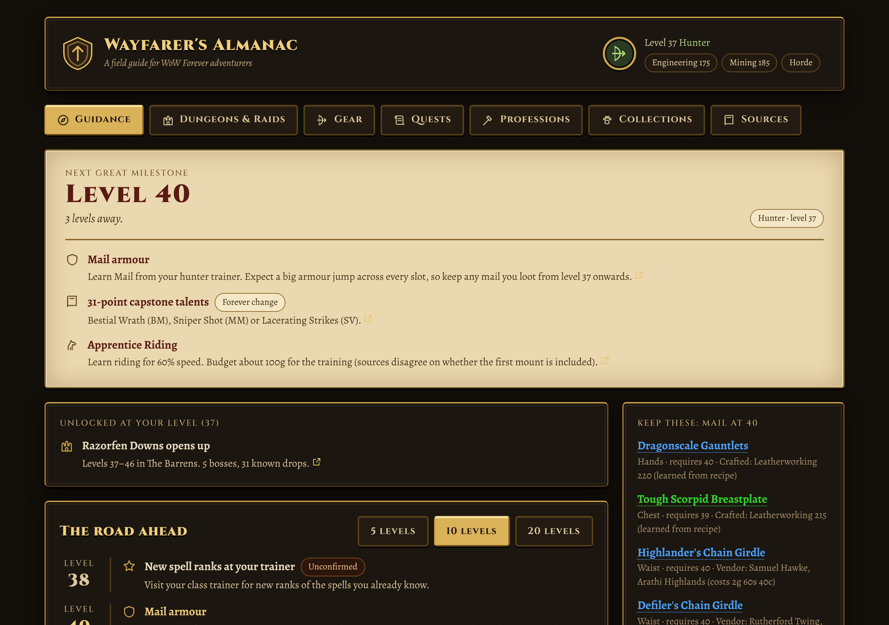

# Wayfarer's Almanac

A companion app for **World of Warcraft: Forever**. It tells you what's coming at your next levels, which dungeons and quests fit you, the best gear you can get at each level, and how to level your professions. The first fully written class is the **hunter**, with Engineering and Mining.



## What's in it

| Page | What it does |
|---|---|
| **Guidance** | Your next big milestone (for example *mail armour at 40*), a level-by-level road ahead for the next 5, 10 or 20 levels, what unlocked at your level, gear to keep for an upcoming armour unlock, dungeons and key quests for your level, and profession goals. |
| **Dungeons & Raids** | All Forever dungeons with level ranges and difficulty colours. Each dungeon shows loot by boss (filtered to your class, with full item tooltips), its quests and bosses. Forever's first three raids and the content roadmap. |
| **Gear** | Best in slot for any level from 1 to 60, ranked with rough class stat weights. Choose whether to include crafted gear, rare world drops and raid loot. Crafted items are flagged when your professions can make them. |
| **Quests** | Dungeon and elite quests near your level, searchable, with rewards, XP and prerequisites, plus your class quests and the Waylaid Supplies reputation. |
| **Professions** | Engineering and Mining: training tiers, the fastest Engineering path to 300, specialisations, mining nodes coloured by your skill, smelting, camp items, Forever changes, and every craftable Engineering item. |
| **Collections** | Rare beasts to tame (for hunters), mounts and companion pets, with an owned checklist saved in your browser. |
| **Sources** | Where every piece of data comes from. |

Your character (class, level, faction, professions) is set by clicking it in the header and is saved in your browser.


## Data

Blizzard's official API doesn't yet expose trainer spells or dungeon loot for Forever, so the app combines:

- **[Forever Companion API](https://forevercompanion.io/developers)**: dungeons, loot, quests, class quests, rares and reputations. Free, no key, open CORS, 120 requests per minute. Responses are cached in the browser for 6 hours.
- **[wow-forever-kb](https://github.com/gBlaku/wow-forever-kb)**: about 22,700 items with stats and sources, rebuilt daily. Loaded at runtime (about 7 MB on first visit) and not copied into this repo, because that repo states no licence.
- **Hand-curated files** in `src/data/`: hunter unlocks by level, general milestones, professions and raids, from warcraft.wiki.gg, Warcraft Tavern, Wowhead and Blizzard's class deep dives. Anything carried over from Classic and not yet confirmed for Forever is marked *Unconfirmed* in the app.

Both feeds can be pointed elsewhere with `VITE_FOREVER_COMPANION_API` and `VITE_KB_ITEMS_URL`.

## Develop

```sh
npm install
npm run dev      # http://localhost:8080
npm test         # unit tests (vitest)
npm run build    # type-check and build to dist/
```

Stack: Vite, React 18, TypeScript, Tailwind CSS, TanStack Query, React Router. It works as a Lovable project: import this GitHub repo into Lovable and it builds as is. There is no backend and nothing to log in to.

## Adding a class

Write a milestone list like `HUNTER_MILESTONES` in `src/data/milestones.ts`, return it from `classMilestones()`, and set `detailedGuidance: true` for that class in `src/data/classes.ts`. Stat weights for the gear planner are in the same file.

---

Fan-made and not affiliated with Blizzard Entertainment. World of Warcraft is a trademark of Blizzard Entertainment.
